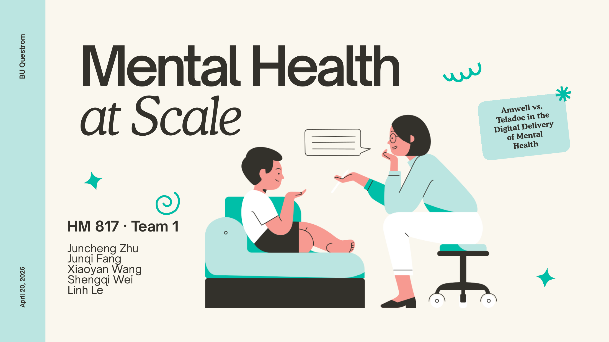
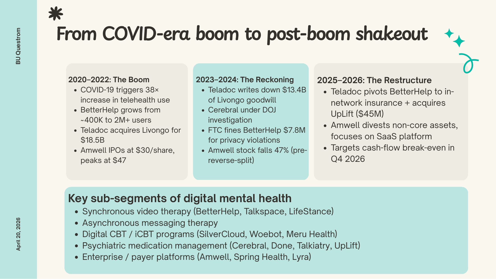
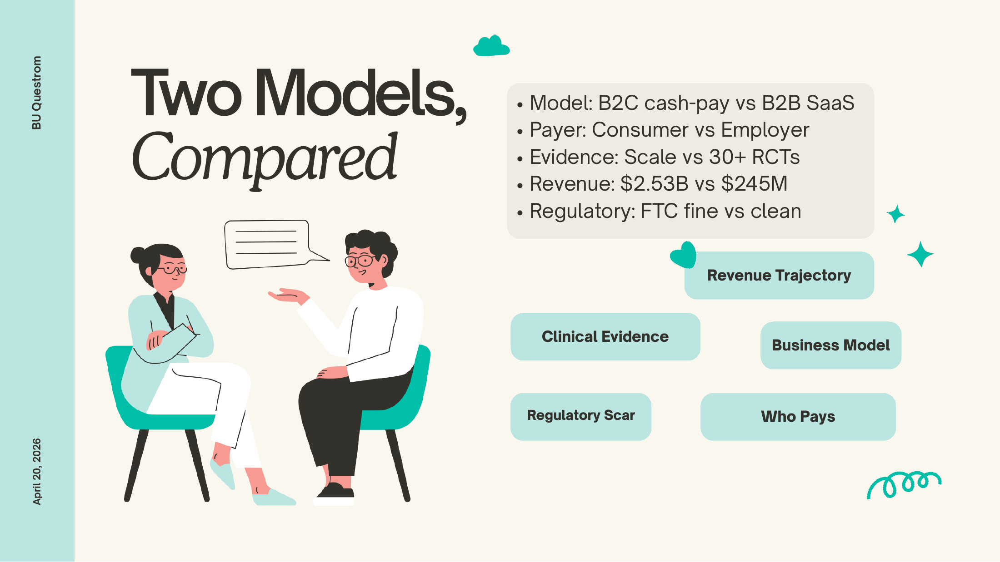
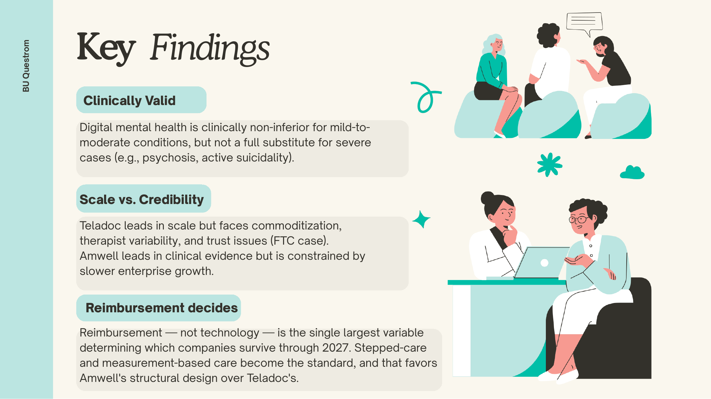
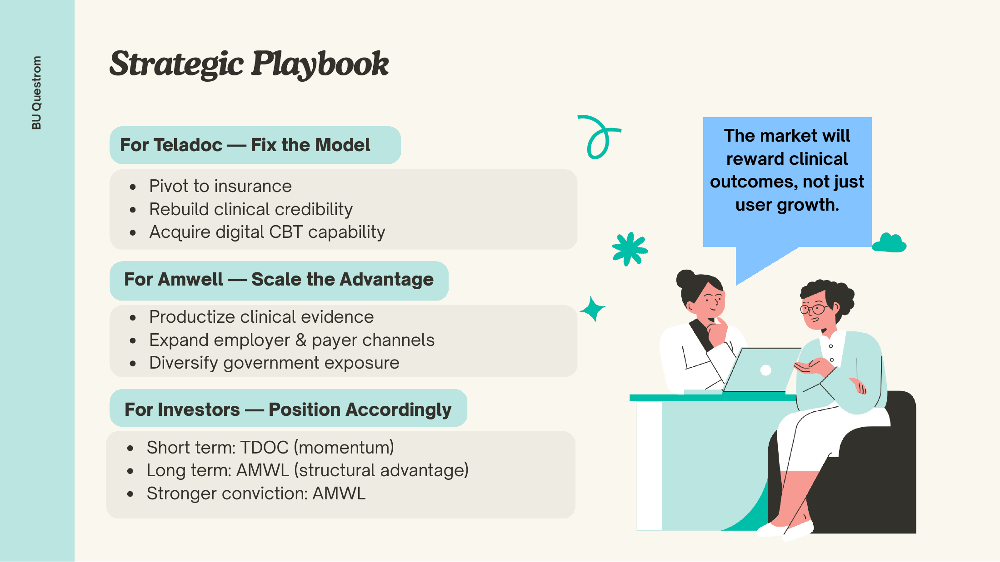

<div align="center">

# Mental Health at Scale: Amwell vs. Teladoc in Digital Mental Health

**HM817 · Advances in Digital Health**<br>
Boston University · Questrom School of Business · MS in Business Analytics · Spring 2026




*Which digital mental health model is built to last: Teladoc's consumer-scale BetterHelp, or Amwell's evidence-based SilverCloud platform?*

</div>

## At a glance

- **Demand far outruns supply.** **23%** of U.S. adults experienced mental illness in 2024 and **21M** had a major depressive episode. **163M** Americans live in mental health shortage areas, HRSA projects a **20%** decline in psychiatrists by 2030, and **28M** adults with mental illness received no treatment.
- **Digital care works for mild-to-moderate cases, not severe ones.** A 2024 meta-analysis of **35 RCTs (n = 4,827)** found telehealth non-inferior to in-person care for depression and anxiety, but self-guided iCBT loses **40–60%** of users and the evidence is inadequate for psychosis or active suicidality.
- **The two companies differ by an order of magnitude in scale.** Teladoc reported FY2025 revenue of **$2.53B** (−2% YoY), with BetterHelp at **$950M** (−9%) and about **38,000** therapists. Amwell reported **$245M** (−22%), with **$219M** cash and a cash-flow break-even target of Q4 2026.
- **Amwell has the stronger clinical evidence.** SilverCloud is backed by **30+** published RCTs, endorsed by NICE in the UK, and deployed by the NHS and the Irish HSE (**55,000+** referrals), with up to **80%** symptom improvement. BetterHelp carries a **$7.8M** FTC privacy fine, and Teladoc's market cap fell from about **$40B** (2021) to about **$1.5B** (April 2026).
- **Verdict: reimbursement, not technology, picks the winner.** The team rates Amwell the more defensible long-term model because measurement-based, stepped care fits payer reimbursement. The investor view is short-term TDOC (momentum) and long-term AMWL, with stronger conviction in AMWL.

## The question

Digital mental health boomed during COVID-19 (telehealth use rose **38×**), then hit a reckoning: Teladoc wrote down **$13.4B** of Livongo goodwill, Cerebral came under DOJ investigation, and BetterHelp was fined by the FTC. By 2025–2026 both leading telehealth companies were restructuring. Teladoc runs a direct-to-consumer, cash-pay therapy business (BetterHelp) and is pivoting to insurance. Amwell sells a B2B SaaS platform with licensed, RCT-backed digital CBT programs (SilverCloud). The project asks how far digital care can go clinically, which business model survives the shakeout, and what each company and its investors should do next.

## Data

This is a strategy and secondary-research project, so no dataset was modeled. The evidence comes from public filings, regulators and the published literature, as cited in the deck's appendix.

| Source | Size (rows/period) | What we used it for |
|---|---|---|
| [Teladoc Health](https://ir.teladochealth.com/) and [Amwell](https://investors.amwell.com/) 10-K filings and Q4 earnings releases | FY2023–FY2025 | Revenue, segment results, net loss, cash, debt and headcount for both companies |
| [NIMH mental illness statistics](https://www.nimh.nih.gov/health/statistics/mental-illness) and [HRSA workforce projections](https://bhw.hrsa.gov/data-research/projecting-health-workforce-supply-demand) | 2024 prevalence; projections to 2030 | Size of demand, the workforce shortage and the treatment gap |
| Telehealth vs. in-person meta-analysis (medRxiv, 2024), Shaker et al. (JMIR Mental Health, 2023), BMC Public Health review (2024), VA Evidence Synthesis Program (2022) | 35 RCTs (n = 4,827); 39 studies; 7 studies | Clinical non-inferiority, user acceptability (71%) and the limits of the evidence |
| SilverCloud research program (Trinity College Dublin) and [NICE](https://www.nice.org.uk/) guidance | 30+ peer-reviewed RCTs | Amwell's clinical evidence base and its NHS / Irish HSE deployments |
| [FTC v. BetterHelp](https://www.ftc.gov/legal-library/browse/cases-proceedings/2023169-betterhelp-inc-matter) (Case C-4796) | Order finalized July 2023 | Privacy risk: $7.8M redress and a 20-year ban on sharing health data for advertising |
| CB Insights Digital Health 50, Healthcare Dive, Fierce Healthcare, Mind Share Partners, WHO | 2025–2026 coverage | Competitive landscape, pricing benchmarks and industry context |

## Approach

1. **Size the problem:** Quantify demand, the clinician shortage and the treatment gap, and name the three clinical gaps digital care could address (access, measurement-based care, severity).
2. **Test the clinical case:** Weigh RCT evidence for digital mental health against its limits for severe conditions, crisis management and engagement.
3. **Trace the market cycle:** Follow the sector from the 2020–2022 boom through the 2023–2024 reckoning to the 2025–2026 restructuring.
4. **Profile and compare:** Compare Teladoc/BetterHelp and Amwell/SilverCloud on scale, technology, clinical evidence, payer, revenue and regulatory record.
5. **Assess risk and competition:** Map the downside for patients, providers, payers/investors and society, and the direct and adjacent competitors.
6. **Recommend:** Set out moves for each company and an investor position.


## Results

<table>
<tr>
<td width="50%"><br><sub><b>Market cycle.</b> A 38× COVID telehealth surge, then a $13.4B Livongo write-down and an FTC fine, then a 2025–2026 restructuring at both companies.</sub></td>
<td width="50%"><br><sub><b>Two models.</b> B2C cash-pay vs. B2B SaaS, consumer vs. employer payer, scale vs. 30+ RCTs, $2.53B vs. $245M revenue, FTC fine vs. clean record.</sub></td>
</tr>
<tr>
<td width="50%"><br><sub><b>Key findings.</b> Digital care is clinically valid for mild-to-moderate conditions, Teladoc has scale but weaker credibility, and reimbursement decides who survives through 2027.</sub></td>
<td width="50%"><br><sub><b>Strategic playbook.</b> Teladoc should fix its model, Amwell should scale its clinical advantage, and investors should hold TDOC short term and AMWL long term.</sub></td>
</tr>
</table>

## Deliverables

| File | Description |
|---|---|
| [`deliverables/HM817_Amwell_vs_Teladoc_Digital_Mental_Health_Team1.pdf`](deliverables/HM817_Amwell_vs_Teladoc_Digital_Mental_Health_Team1.pdf) | Final Part C team presentation (20 slides including appendix), PDF exported from Canva |

## Repository layout

```text
.
├── README.md
├── LICENSE
├── .gitignore
├── assets/
│   ├── cover.png
│   ├── slide-07-boom-to-shakeout.png
│   ├── slide-10-two-models.png
│   ├── slide-14-key-findings.png
│   └── slide-18-strategic-playbook.png
└── deliverables/
    └── HM817_Amwell_vs_Teladoc_Digital_Mental_Health_Team1.pdf
```

## Sources

There is no code to run. Every input comes from public sources, and the main ones are below (the full list is in the deck's appendix).

- Teladoc Health. [Investor Relations](https://ir.teladochealth.com/): 10-K filings for FY2023–FY2025 and Q4 earnings releases.
- Amwell (American Well Corporation). [Investor Relations](https://investors.amwell.com/): 10-K filings for FY2023–FY2025 and Q4 earnings releases.
- U.S. Federal Trade Commission. [BetterHelp, Inc., In the Matter of](https://www.ftc.gov/legal-library/browse/cases-proceedings/2023169-betterhelp-inc-matter) (Case C-4796, finalized July 2023).
- National Institute of Mental Health. [Mental Illness statistics](https://www.nimh.nih.gov/health/statistics/mental-illness).
- HRSA. [Health workforce projections](https://bhw.hrsa.gov/data-research/projecting-health-workforce-supply-demand) and mental health professional shortage area data.
- Telehealth vs. in-person psychotherapy meta-analysis of 35 RCTs (medRxiv, 2024); Shaker et al. (2023), *JMIR Mental Health*; BMC Public Health (2024) review of 39 studies; VA Evidence Synthesis Program (2022) on in-home video care for PTSD.
- Richards and colleagues, Trinity College Dublin: SilverCloud randomized controlled trials. UK [National Institute for Health and Care Excellence (NICE)](https://www.nice.org.uk/).
- Mind Share Partners (2025) Mental Health at Work Report; WHO (2025) World Mental Health Today; CB Insights Digital Health 50 (2025); Healthcare Dive and Fierce Healthcare coverage.

## Team

HM817 Team 1: Juncheng Zhu, Junqi Fang, Xiaoyan Wang, Shengqi Wei, Linh Le

---
<sub>Course project for HM817 at Boston University. Instructor-provided materials (slides, assignment briefs, cases, solutions) are not included.</sub>
